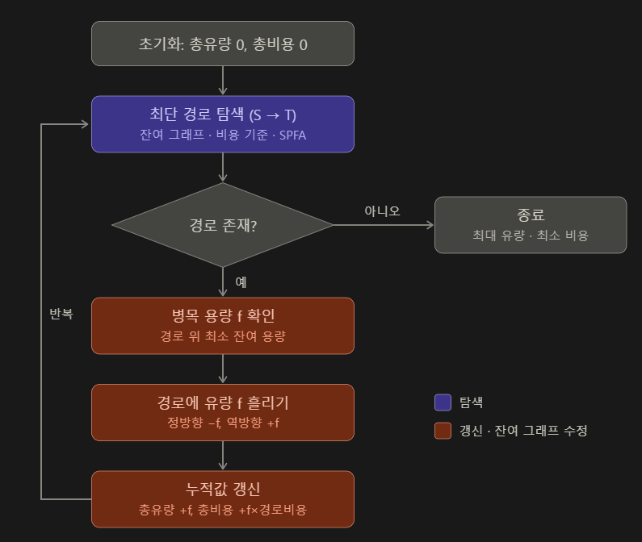

# Dijkstra (다익스트라)

## 알고리즘 도식화

## 목적
특정 지점에서 다른 지점까지의 최단 거리를 구하는 알고리즘입니다.  

## 생각의 흐름
거리 비용을 저장해둡니다. 이 때 시작 지점은 0, 그 외 지점은 `INF`로 둡니다.  
아직 방문하지 않은 지점 중 거리가 가장 짧은 지점을 선택하고, 방문 처리합니다. 간선 비용이 모두 0 이상이기 때문에 이 지점까지의 거리가 최단 거리로 확정됩니다.  
선택한 지점까지의 거리 + 간선 비용을 기존에 저장된 거리와 비교해서, 더 작은 값으로 갱신해줍니다.  
더 이상 선택할 지점이 없으면 종료하고, 도착 지점의 거리를 반환합니다. 선택할 수 있는 지점이 남았다면 위의 과정을 반복합니다.

## 시간 복잡도

- 우선순위 큐(이진 힙)을 사용할 때 : **O((V + E) log V)**  
> 일반적인 경우  

- 배열을 매번 훑어서 최솟값을 찾을 때 : **O(V²)**   
> 간선이 V²에 가까운 그래프에서 유리

- 피보나치 힙을 사용할 때 : **O(V log V + E)**  
> 이론상 가장 빠르지만 구현 난이도가 높음

## 공간 복잡도

- 그래프 저장 : **O(V + E)**  

- 비용, 방문 정보 저장 : **O(V)**  

- 우선 순위 큐 : 최대 E개 -> **O(E)**

결과적으로 **O(V + E)**

## 주의 사항
가장 싼 지점을 확정하는 방식인데, 음수 간선이 존재하면 이후에 더 싼 곳이 나올 수 있기 때문에 그래프에 음수 간선이 포함된 경우는 사용하지 않습니다.  
만약 사용해야 한다면 포텐셜로 비용을 보정해줘야 합니다.  

[**예제 코드**](https://github.com/uselessnaming/cs-kotlin/blob/main/src/algorithm/Dijkstra.kt)