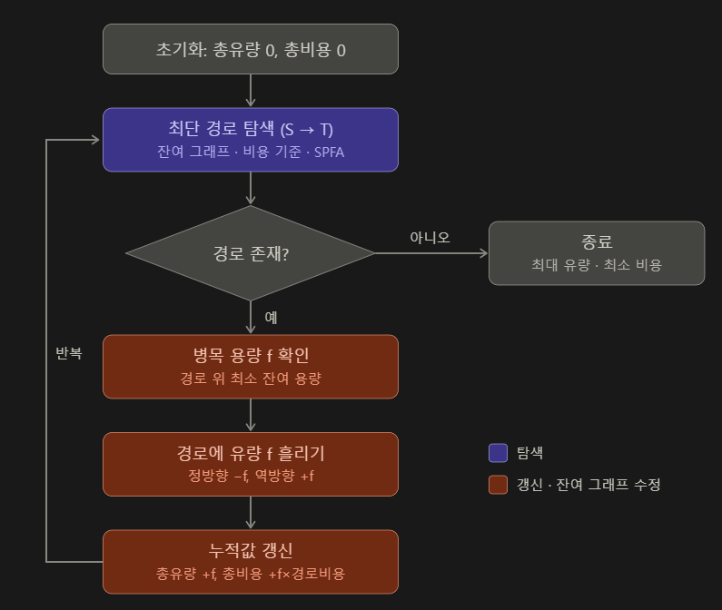

# MCMF (Min-Cost Max-Flow)
  
> 알고리즘 도식화

최소 비용 최대 유량 알고리즘이라고도 불립니다.  

## 목적
첫 지점에서 목적지까지 보내는 양(유량)을 최대로 하고, 그 양을 보내는 방법 중 최종 비용이 가장 적은 방법을 찾는 알고리즘입니다.  

## 생각의 흐름
첫 지점 S에서 도착 지점 T까지 capacity가 남은 도로만 사용해서 비용의 합이 가장 적은 경로를 찾습니다.  
해당 경로에서 가장 적은 capacity인 cap을 찾습니다. (최소 capacity만큼만 사용이 가능하기 때문)   
경로 위 모든 간선의 capacity에서 cap만큼 뺀 후, 되돌리기 간선에 cap만큼 더해둡니다.  
(이번 경로에 대한 비용 * cap)을 전체 비용에 더해줍니다.  
위와 같은 과정을 반복하게 됩니다.  
과정 반복 중 경로가 더 이상 없다면 반복을 종료합니다.  

간선 A->B를 추가할 때에는 되돌리기 간선인 B->A 또한 capacity는 0으로, cost는 -cost로 만들어둡니다. A->B로 보낸 만큼 B->A의 capacity가 늘어나서, 앞서 잘못 고른 경로를 그만큼 취소하고 비용을 돌려받을 수 있습니다.  
  
> 다익스트라는 간선에 음수 비용이 발생할 경우, 동작에 오류가 생깁니다. MCMF의 경우, 되돌리기 간선 비용이 음수로 발생하기 때문에 이 부분을 처리하기 적합하지 않습니다. 따라서 이를 처리하기 위해 포텐셜을 이용합니다.  
> 포텐셜 `h[v]`는 s에서 v까지의 최단 비용입니다. 간선 비용을 `cost + h[u] - h[v]`로 바꾸면 이 간선을 사용했을 때 v까지 가장 저렴한 방법보다 얼마나 손해인가를 의미합니다. 이 값은 항상 0 이상이므로 다익스트라를 사용할 수 있게 됩니다. 다익스트라가 끝나면 `h[v] += dist[v]`로 실제 최단 비용으로 되돌리고, 이 경로의 실제 비용은 `h[t]`입니다.  

## 시간 복잡도
V는 노드의 개수, E는 간선 개수, F는 최종적으로 보내는 최대 유량일 때

최단 경로를 벨만-포드 혹은 SPFA로 찾을 때 : **O(F * V * E)**  

다익스트라 + 포텐셜을 사용했을 때 : **O(F * E * logV)**  
> 음수 간선이 존재할 때 : **O(V * E + F * E * Log V)**

## SPFA vs 다익스트라 + 포텐셜 소요 시간 비교
.png>)  
> 정점 4개 (시간 단위 : us)  

.png>)  
> 정점 802개 (시간 단위 : ms)  

.png>)  
> 정점 1602개 (시간 단위 : ms)  

그래프의 규모가 작을 때에는 두 방법의 소요 시간이 비슷하게 보입니다. 다만 그래프의 규모가 커짐에 따라 다익스트라 + 포텐셜 방법이 더 빠른 것을 확인할 수 있었습니다.  다만 어느 쪽이 빠른 지는 정점의 수 뿐만 아니라 그래프의 모양에 따라 달라질 수 있습니다.

SPFA 방법의 경우, 현재 이동 가능한 노선을 살펴보며 더 싼 비용이 발생하면 해당 정점을 다시 큐에 넣어, 그 정점의 간선을 다시 확인하는 방법입니다.  
그에 비해 다익스트라 + 포텐셜 방법은 아직 확정되지 않은 정점 중 비용이 가장 싼 정점을 꺼내, 그 정점까지의 최단 비용을 확정합니다. 확정한 정점을 다시 처리하지 않습니다.    
다익스트라는 우선 순위 큐에서 발생하는 비용이 Log V인 것에 비해 SPFA에서 최악의 경우 정점 하나를 다시 처리할 수 있는 최대 비용이 V 이므로 시간 차이가 발생하게 됩니다. 

## 공간 복잡도
인접 리스트로 구현했다면 **O(V + E)**의 공간 복잡도  

2차원 배열로 구현하면 **O(V * V)**로 메모리를 많이 소모하게 됩니다.  

## 주의 사항
처음 그래프에 음수 사이클이 존재한다면 이 방법을 그대로 사용할 수는 없습니다.    

> 여기서 음수 사이클이란 사이클이 존재하고, 이 사이클에서 발생하는 비용의 총합이 음수인 것을 말합니다.  

음수 사이클이 존재할 경우, 해당 사이클을 돌수록 더 싼 값이 생기게 됩니다. 그렇기 때문에 SPFA 방법을 사용하면 계속 값을 갱신해야 하는 문제가 발생합니다. 다익스트라의 경우, 최단 경로를 확정지어야 하는데, 돌수록 계속 최단 경로가 발생하므로 사용할 수 없습니다.  

음수 사이클이 있는 그래프는 사이클 제거 같은 다른 방법을 통해 해결해야 합니다.

[**예제 코드(SPFA)**](https://github.com/uselessnaming/cs-kotlin/blob/main/src/algorithm/MCMFSpfa.kt)  
[**예제 코드(Dijkstra)**](https://github.com/uselessnaming/cs-kotlin/blob/main/src/algorithm/MCMFDijkstra.kt)