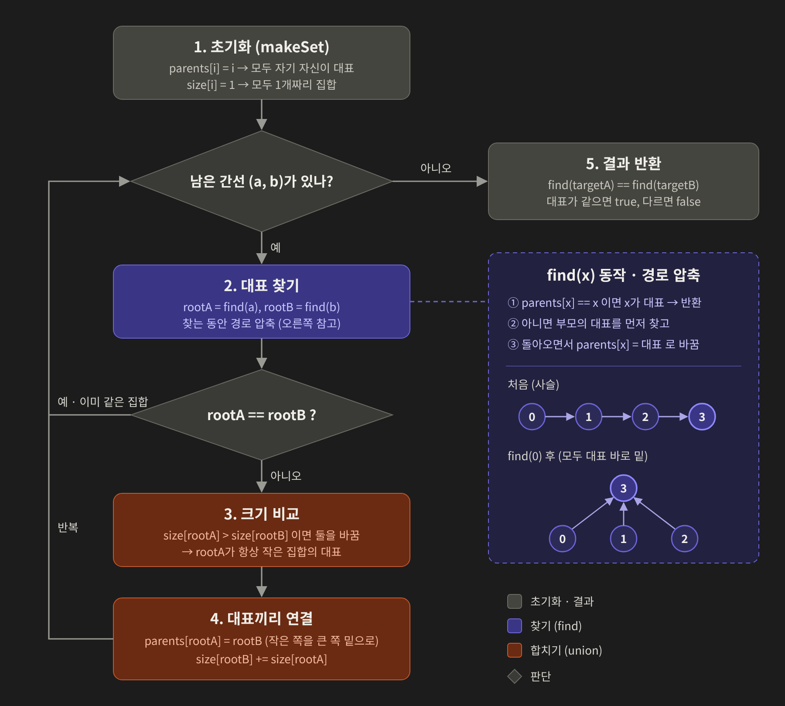

# Union-Find 알고리즘
서로소 집합 알고리즘이라고도 불립니다.

## 알고리즘 도식화

## 목적
여러 개의 노드가 존재할 때, 두 노드를 선택해서 같은 집합에 속하는지 판별하는 알고리즘입니다.

## 생각의 흐름
Union-Find 알고리즘은 초기화(makeSet) - 합치기(union) - 찾기(find) 연산 과정을 가집니다.  
- 초기화 단계 - union과 find 전 각 노드를 하나의 집합으로 초기화 하는 과정입니다. 하나의 유일한 노드를 가지는 집합으로 생성해둡니다.  
- 합치기 단계 - 집합을 합치는 과정입니다. 두 원소의 대표를 각각 찾고, 대표끼리 연결합니다.  
- 찾기 단계 - 주어진 노드가 속한 집합의 대표 노드를 반환합니다.

## 최적화 방안
union 단계에서 단순히 부모 값을 갱신하게 하면 재귀의 깊이가 깊어질 수 있습니다. 이를 방지하기 위해서 크기가 더 작은 집합을 더 큰 집합으로 넣어두어 재귀의 깊이를 얕게 관리할 수 있습니다.  

find 단계에서 찾고 돌아오는 길에 지나온 노드들의 부모를 대표 값으로 변경해두면 다음 찾기 과정에서 더 빠르게 진행할 수 있습니다.  

## 시간 복잡도
> N: 원소 개수 / M: union할 간선 개수 / targetA, targetB : 같은 집합에 있는 지 확인할 원소들  

- makeSet 단계 : O(1) N번 반복 => **O(N)**  
> parents, size 채우기  

- union 단계 : **(find 비용) * M**  
> find 2번 + 비교, 연결, 덧셈  

- find 단계 : **(find 비용) * 2**  
> targetA와 targetB에 대한 find 비용

- 경로 압축 + 크기 기준 합치기를 사용한 총 시간 복잡도 : **O(N + M·α(N))**
> α(N)은 역 아커만 함수로, 현실적인 모든 N에서 4 이하라 실제로는 O(N + M)에 가깝게 동작합니다.
> 다만 상수가 아니므로 Big-O에서 생략하지는 않습니다.

### find 비용
- 최적화 없을 경우 : **O(N)**
- 크기 기준 합치기만 : **O(log N)**
- 경로 압축만 : **평균(분할 상환) O(log N)**
- 둘 다 적용 : **평균(분할 상환) O(α(N))**

## 공간 복잡도
> N: 원소 개수 / M: union할 간선 개수  

- parents 배열 : N개  

- size 배열 : N개  

- 총합 : **O(N)**  

[**예제 코드**](https://github.com/uselessnaming/cs-kotlin/blob/main/src/algorithm/UnionFind.kt)